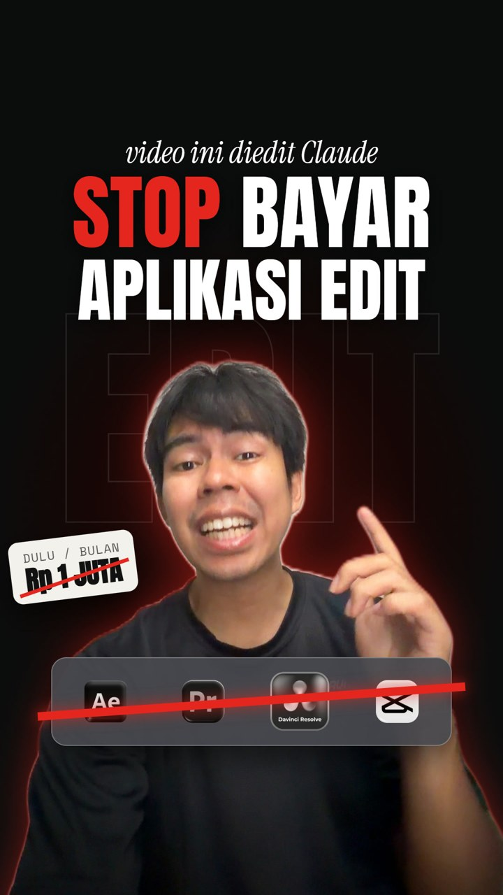
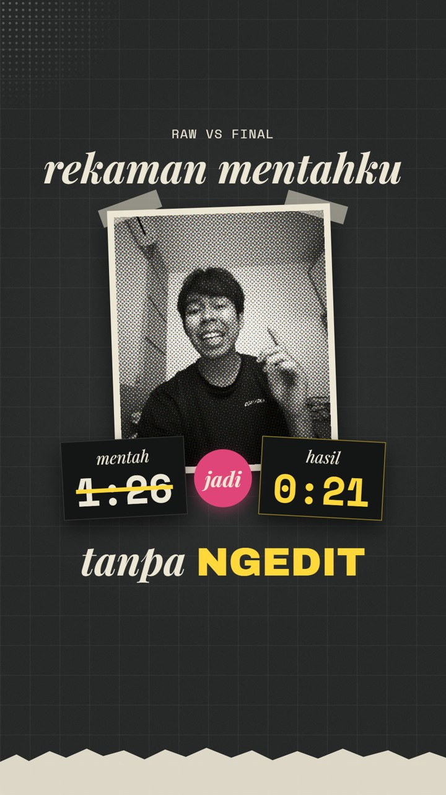
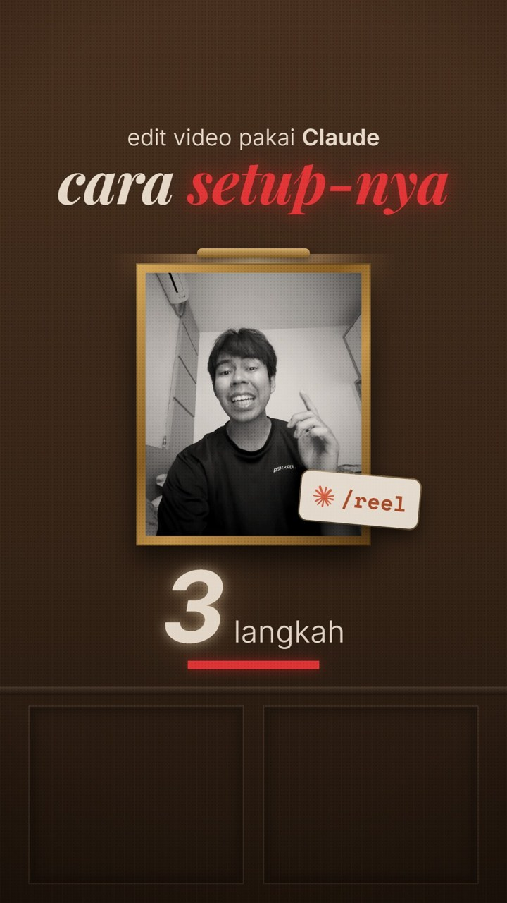

# Manual: from an idea to a finished Reel, edited by Claude

[Versi Bahasa Indonesia](MANUAL.md)

You bring the idea and record it. Claude writes the script, picks your best takes, cuts pauses and
repeated words, adds effects, captions and music, and gives you a final file, a cover and a post
caption. Everything runs on your own computer through Claude Code.

The example prompts are in Bahasa Indonesia, as the reels were; Claude understands any language, so
write yours in whatever you speak.

---

## Example results

Three Reels made with this pipeline (click a cover to watch):

| [](examples/01-stop-langganan.mp4) | [](examples/02-raw-vs-final.mp4) | [](examples/03-setup-part-2.mp4) |
|---|---|---|
| **Stop paying for editing apps** (21 s). Face + voice recording. | **Raw vs final** (26 s). An 86 s voice recording cut to 21 s without opening an editing app. | **Setup part 2** (32 s). Voice only, the picture is all motion graphics. |

What the pipeline did in all three: script, transcript, take picking, cutting pauses and repeated
words, background music (MusicGen), Instagram-ready loudness, cover and caption.

**Being honest about the look:** the motion graphics in examples 2 and 3 (and the overlays in
example 1) were made on top with [HyperFrames](https://hyperframes.heygen.com), with Claude writing
each scene. That is **not** automatic in this repo. Without HyperFrames you get the talking-head
version with 51 face-tracking effects, captions and on-screen text (see section 9 to try motion
graphics).

---

## 1. What you need

- A **Windows, Mac or Linux** computer with about 4 GB free (8 GB with music).
- A paid Claude plan (Pro or Max) to use **Claude Code**.
- **Python 3.10 or newer.**
  - Windows: `winget install Python.Python.3.12`
  - Mac: `brew install python@3.12`
- A phone to record with.

You don't need to install ffmpeg or git yourself: Claude installs them if they're missing.

## 2. Install Claude Code

Either:

- **The Claude desktop app** (easiest): download from [claude.ai/download](https://claude.ai/download),
  sign in, open the **Code** tab.
- **Terminal:**
  - Mac / Linux: `curl -fsSL https://claude.ai/install.sh | bash`
  - Windows (PowerShell): `irm https://claude.ai/install.ps1 | iex`

  then type `claude` and sign in.

## 3. Get the pipeline folder

- **With git:**
  ```bash
  git clone https://github.com/kidsavagez/CLAUDE-VIDEO-PIPLINE.git
  ```
- **Without git:** on the GitHub page click **Code → Download ZIP** and unzip it.

## 4. First-time setup (once)

1. Open the `CLAUDE-VIDEO-PIPLINE` folder in Claude Code (desktop app: pick the folder when you start
   a session; terminal: `cd` into it and type `claude`).
2. Type:

   ```
   Tolong setup pipeline ini di komputerku.
   ```
   ("Please set this pipeline up on my computer.")

3. Claude installs ffmpeg/git if needed, runs `install.py` (creates `.venv/`, installs the
   transcriber and downloads the effects from claude-video-effects), then the self-test.
   **Setup worked when you see `9/9 passed`.**
4. Want free background music made on your own computer? Type:

   ```
   Install juga bagian musiknya.
   ```
   ("Install the music part too." Runs `python install.py --music`, about 1 GB, once.)

The first transcription downloads the Whisper model once (a few hundred MB up to 3 GB).

### Optional: make the script sound like you

`/reel` reads your voice profile (`voice.md`) from Jake Schincariol's
[instagram-agent-skill](https://github.com/Jakeschincariol/instagram-agent-skill) or
[youtube-agent-skill](https://github.com/Jakeschincariol/youtube-agent-skill) when one is installed.
It works without them, but the scripts are more generic. Type:

```
Install skill dari https://github.com/Jakeschincariol/instagram-agent-skill, terus bikinin voice.md-ku dari 3 Reel ini.
```
("Install the skill from ..., then write my voice.md from these 3 Reels." Attach or point to three
of your own Reels. It's saved to `~/.claude/instagram/voice.md`. For YouTube, use the
youtube-agent-skill link; it saves to `~/.claude/youtube/voice.md`.)

## 5. Make your first video

### Step 1: give the idea

```
/reel ide: berhenti langganan aplikasi edit, karena sekarang Claude bisa edit video otomatis. Bahasa Indonesia, sekitar 30 detik.
```
("idea: stop paying for editing apps, because Claude can now edit video automatically. Indonesian, about 30 seconds.")

No idea yet?

```
Kasih aku 3 ide konten Reels dengan retensi tinggi soal edit video pakai AI.
```
("Give me 3 high-retention Reel ideas about editing video with AI.")

### Step 2: check and change the script

Claude makes a project folder in `projects/` with a `brief.md`: hook options, the script line by
line, and which effect lands on which word. Change it in plain words:

```
Ganti kalimat nomor 7 jadi "sekarang aku buang semua dan pindah ke Claude", hapus nomor 8.
```
("Change line 7 to '...', delete line 8.")

```
Ganti CTA jadi "Komen INGFO untuk dapetin filenya".
```
("Change the call to action to 'Comment INGFO to get the files'.")

```
Hook-nya kurang nendang, kasih 3 pilihan lain yang lebih bikin penasaran.
```
("The hook isn't punchy enough, give me 3 more that create curiosity.")

### Step 3: record

Follow `brief.md` and [templates/shooting.md](templates/shooting.md). The important ones:

- **Made a mistake? Pause one second, then say the WHOLE line again.** Claude keeps the last
  complete take automatically.
- About one second of pause between lines.
- Quiet room, AC and fans off, phone a hand's width from your mouth.

Put the recording in the project's `raw/` folder (for example `projects/2026-11-10-stop-langganan/raw/`)
and type:

```
Videonya udah aku taruh di folder raw, lanjut edit.
```
("The video is in the raw folder, go ahead and edit.")

### Step 4: watch the preview, give notes

Claude renders `preview/preview_v1.mp4` with a list of takes used, what was cut and where the
effects are. Watch it, then give notes in plain words:

```
Di detik 13 sampai akhir masih ada kata yang keulang, tolong bersihin.
```
("From 13 s to the end there are still repeated words, clean them up.")

```
Kalimat 3 pakai take yang pertama aja.
```
("Use the first take for line 3.")

```
Efek di detik 7 kebesaran, kecilin. Caption-nya jangan dari awal, jadiin cadangan aja.
```
("The effect at 7 s is too big. Don't start captions at the beginning, keep them as backup only.")

```
Tambahin musik latar yang santai, jangan nutupin suaraku.
```
("Add relaxed background music that doesn't cover my voice.")

Repeat until it's right. Each round becomes `preview_v2.mp4`, `preview_v3.mp4` and so on.

### Step 5: final

```
Udah oke, finalisasi.
```
("Looks good, finalize.")

You get, in `final/`:

- `final.mp4`: 1080x1920 at -14 LUFS (Instagram's loudness)
- `cover.jpg`: the thumbnail
- `caption.md`: a ready-to-paste caption, hook in the first 125 characters, at most 5 hashtags

Want a designed cover instead of a video frame?

```
Bikinin thumbnail sendiri, jangan ambil dari frame video. Pakai fotoku dan judul besar.
```
("Design a thumbnail, don't take a frame from the video. Use my photo and a big headline.")

**Claude never posts anything.** You upload to Instagram yourself. Trending audio can only be added
inside the Instagram app.

## 6. Use an editing style you like

Put 1 to 3 reference Reels (.mp4) in the project folder, then:

```
Pelajari gaya edit dari video referensi di folder ini, terus pakai buat video ini.
```
("Learn the editing style from the reference videos in this folder and use it for this video.")

Claude measures cut pace, shot length and loudness, looks at frames, and writes
`styles/<name>.json` and `styles/<name>.md`. Correct what it got wrong; every video after that uses
it. It sees still frames, not motion or sound: point at exact moments ("the zoom at 0:07") to get
closer.

## 7. Faceless videos (voice only)

```
Aku cuma mau rekam suara, sisanya full motion graphic.
```
("I only want to record my voice, the rest is motion graphics.")

Record with your phone's voice recorder and put the audio (.m4a, .mp3, .wav) in `raw/`. Claude cuts
it with `scripts/cut_voice.py` into a clean `work/voice.wav`, plus the time of every word
(`work/prog_words.json`) to build visuals on. Make the visuals yourself in CapCut, or ask Claude to
build them with HyperFrames (section 9).

## 8. Background music

After `install.py --music`:

```
Bikinin musik latar lo-fi yang santai dan stabil, 30 detik, terus pasang di video ini.
```
("Make a relaxed, steady 30-second lo-fi background track and put it in this video.")

Claude generates it with MusicGen on your computer (`scripts/music_bed.py`), checks for empty
stretches (tries another seed if there are any), and sets it about 14 dB under your voice.
Licence note: the MusicGen weights are non-commercial (CC-BY-NC 4.0); see [CREDITS.md](CREDITS.md).

## 9. Optional: motion graphics like examples 2 and 3

This is outside the pipeline and needs Node.js + [HyperFrames](https://hyperframes.heygen.com). If
it's set up in your Claude Code, send a link to a style you like:

```
Pakai suaraku yang sudah dipotong, bikin full motion graphic dengan gaya seperti referensi ini: <link>. Tambahin sound effect dan musik latar, semua di dalam safe zone Instagram.
```
("Use my cut voice, make full motion graphics in the style of this reference. Add sound effects and
background music, everything inside Instagram's safe zone.")

The result depends on your direction: give notes as usual ("the typography doesn't match", "text
hits the like button", "from 9 to 15 s show the real process in a Claude chat").

## 10. Troubleshooting

| Problem | Type or do |
|---|---|
| `ffmpeg is missing` or `git is missing` | `Tolong install ffmpeg dan git untukku` ("install ffmpeg and git for me"), then open a new terminal |
| `cublas64_12.dll` or another GPU error | The pipeline falls back to the CPU on its own. If it still fails, create `config.json` with `{"whisper_device": "cpu"}` |
| Repeated words survive the cut | `Transkrip ulang per potongan suara (burst), masih ada pengulangan` ("re-transcribe burst by burst, there are still repeats"; runs `scripts/burst_transcribe.py`) |
| A word transcribed wrong ("cloud" for Claude, etc.) | Just say the fix: `"Jeddah" itu maksudnya "jeda"` |
| The effects render is slow | Normal on a CPU: every frame goes through face tracking. Let it run |
| The result isn't what you wanted | Give notes in plain words, as specific as you can (which second, which line) |

## 11. Privacy

- Your video and audio files stay on your computer. Claude reads transcripts and some still frames
  to check the edit.
- `projects/` (your recordings), `.venv/`, `.venv-music/`, `vendor/` and `config.json` never go into
  git (they're in `.gitignore`).

Thanks to every open-source project this uses: see [CREDITS.md](CREDITS.md).
