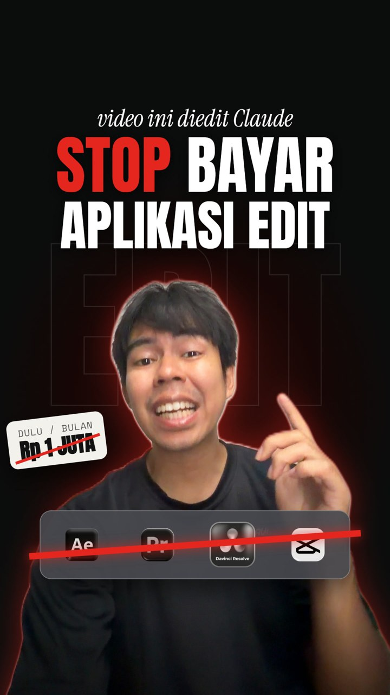
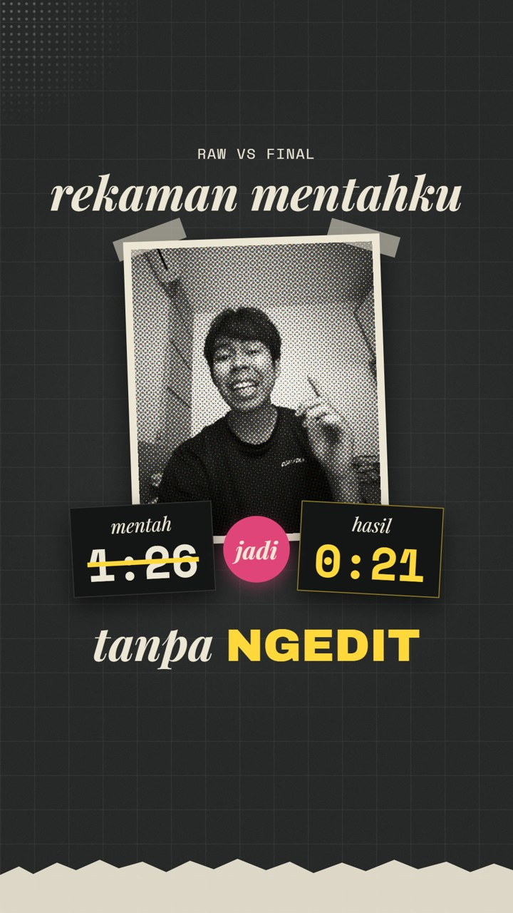
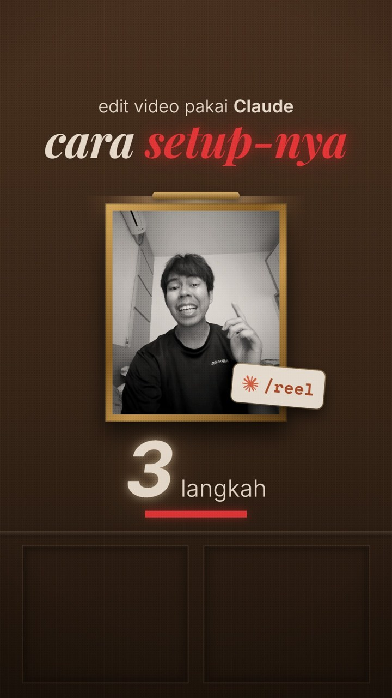

# Panduan: dari ide sampai Reel jadi, diedit Claude

[English version](MANUAL.en.md)

Kamu cukup punya ide dan merekam. Claude yang menulis naskah, memilih take terbaik, memotong jeda dan
kata yang keulang, menambah efek, caption, dan musik, lalu memberi kamu file final + cover + caption
untuk diposting. Semua jalan di komputer kamu sendiri lewat Claude Code.

---

## Contoh hasil

Tiga Reel ini dibuat dengan pipeline ini (klik cover untuk menonton):

| [](examples/01-stop-langganan.mp4) | [](examples/02-raw-vs-final.mp4) | [](examples/03-setup-part-2.mp4) |
|---|---|---|
| **Stop langganan aplikasi edit** (21 dtk). Rekam muka + suara. | **Raw vs final** (26 dtk). Rekaman suara 86 dtk jadi 21 dtk, tanpa buka aplikasi edit. | **Setup part 2** (32 dtk). Suara saja, sisanya motion graphic. |

Yang dikerjakan pipeline di ketiganya: naskah, transkrip, pilih take, potong jeda dan kata yang
keulang, musik latar (MusicGen), loudness siap Instagram, cover, dan caption.

**Jujur soal tampilannya:** tampilan motion graphic di contoh 2 dan 3 (dan overlay di contoh 1)
dibuat tambahan pakai [HyperFrames](https://hyperframes.heygen.com), dengan Claude menulis tiap
adegannya. Itu **tidak otomatis** ikut di repo ini. Tanpa HyperFrames, hasilmu adalah versi
talking-head dengan 51 efek face-tracking, caption, dan teks di layar (lihat bagian 9 kalau mau
coba motion graphic).

---

## 1. Yang kamu butuhkan

- Komputer **Windows, Mac, atau Linux**. Ruang kosong sekitar 4 GB (8 GB kalau pakai musik).
- Akun Claude berbayar (Pro atau Max) untuk memakai **Claude Code**.
- **Python 3.10 atau lebih baru.**
  - Windows: `winget install Python.Python.3.12`
  - Mac: `brew install python@3.12`
- HP untuk merekam. Tidak perlu kamera khusus.

ffmpeg dan git tidak perlu kamu pasang sendiri: Claude akan memasangnya kalau belum ada.

## 2. Pasang Claude Code

Pilih salah satu:

- **Aplikasi desktop Claude** (paling gampang): unduh dari [claude.ai/download](https://claude.ai/download),
  login, lalu buka tab **Code**.
- **Terminal:**
  - Mac / Linux: `curl -fsSL https://claude.ai/install.sh | bash`
  - Windows (PowerShell): `irm https://claude.ai/install.ps1 | iex`

  lalu ketik `claude` dan login.

## 3. Ambil folder pipeline

- **Pakai git:**
  ```bash
  git clone https://github.com/kidsavagez/CLAUDE-VIDEO-PIPLINE.git
  ```
- **Tanpa git:** di halaman GitHub klik **Code → Download ZIP**, lalu ekstrak.

## 4. Setup pertama (sekali saja)

1. Buka folder `CLAUDE-VIDEO-PIPLINE` di Claude Code (aplikasi desktop: pilih folder saat membuat
   sesi baru; terminal: `cd` ke folder itu lalu ketik `claude`).
2. Ketik:

   ```
   Tolong setup pipeline ini di komputerku.
   ```

3. Claude akan memasang ffmpeg/git kalau belum ada, menjalankan `install.py` (membuat `.venv/`,
   memasang transkriber, dan mengunduh efek dari claude-video-effects), lalu menjalankan tes.
   **Setup berhasil kalau muncul `9/9 passed`.**
4. Mau musik latar gratis yang dibuat di komputermu sendiri? Ketik:

   ```
   Install juga bagian musiknya.
   ```

   (Ini menjalankan `python install.py --music`, sekitar 1 GB, sekali saja.)

Transkripsi pertama akan mengunduh model Whisper sekali (beberapa ratus MB sampai 3 GB).

### Opsional: supaya naskahnya terdengar seperti kamu

`/reel` membaca profil gaya bicaramu (`voice.md`) dari skill
[instagram-agent-skill](https://github.com/Jakeschincariol/instagram-agent-skill) atau
[youtube-agent-skill](https://github.com/Jakeschincariol/youtube-agent-skill) buatan Jake
Schincariol, kalau sudah terpasang. Tanpa itu pun tetap jalan, tapi naskahnya lebih umum. Ketik:

```
Install skill dari https://github.com/Jakeschincariol/instagram-agent-skill, terus bikinin voice.md-ku dari 3 Reel ini.
```

(Lampirkan atau tunjukkan 3 Reel milikmu. Hasilnya tersimpan di `~/.claude/instagram/voice.md`.
Untuk YouTube, pakai link youtube-agent-skill; hasilnya di `~/.claude/youtube/voice.md`.)

## 5. Bikin video pertama

### Langkah 1: kasih ide

```
/reel ide: berhenti langganan aplikasi edit, karena sekarang Claude bisa edit video otomatis. Bahasa Indonesia, sekitar 30 detik.
```

Belum punya ide?

```
Kasih aku 3 ide konten Reels dengan retensi tinggi soal edit video pakai AI.
```

### Langkah 2: cek dan ubah naskah

Claude membuat folder project di `projects/`, berisi `brief.md`: pilihan hook, naskah per kalimat,
dan efek apa muncul di kata apa. Ubah sesukamu dengan bahasa biasa:

```
Ganti kalimat nomor 7 jadi "sekarang aku buang semua dan pindah ke Claude", hapus nomor 8.
```

```
Ganti CTA jadi "Komen INGFO untuk dapetin filenya".
```

```
Hook-nya kurang nendang, kasih 3 pilihan lain yang lebih bikin penasaran.
```

```
Aku pilih hook A.
```

### Langkah 3: rekam

Ikuti `brief.md` dan [templates/shooting.md](templates/shooting.md). Yang paling penting:

- **Salah ngomong? Diam satu detik, lalu ulang SATU KALIMAT PENUH dari awal.** Claude otomatis
  memakai take terakhir yang lengkap.
- Jeda sekitar satu detik di antara kalimat.
- Ruangan sepi, AC/kipas mati, HP sejengkal dari mulut.

Taruh file rekaman di folder `raw/` project-nya (contoh: `projects/2026-11-10-stop-langganan/raw/`),
lalu ketik:

```
Videonya udah aku taruh di folder raw, lanjut edit.
```

### Langkah 4: tonton preview, kasih catatan

Claude merender `preview/preview_v1.mp4` dan memberi daftar: take yang dipakai, apa yang dipotong,
efek di mana. Tonton, lalu kasih catatan dengan bahasa biasa:

```
Di detik 13 sampai akhir masih ada kata yang keulang, tolong bersihin.
```

```
Kalimat 3 pakai take yang pertama aja.
```

```
Efek di detik 7 kebesaran, kecilin. Caption-nya jangan dari awal, jadiin cadangan aja.
```

```
Tambahin musik latar yang santai, jangan nutupin suaraku.
```

Ulangi sampai pas. Setiap putaran jadi `preview_v2.mp4`, `preview_v3.mp4`, dan seterusnya.

### Langkah 5: final

```
Udah oke, finalisasi.
```

Hasilnya di folder `final/`:

- `final.mp4`: 1080x1920, loudness -14 LUFS (standar Instagram)
- `cover.jpg`: thumbnail
- `caption.md`: caption siap tempel, hook di 125 karakter pertama, maksimal 5 hashtag

Mau cover yang didesain, bukan potongan frame video?

```
Bikinin thumbnail sendiri, jangan ambil dari frame video. Pakai fotoku dan judul besar.
```

**Claude tidak pernah memposting apa pun.** Kamu yang upload ke Instagram. Audio trending hanya bisa
ditambahkan di dalam aplikasi Instagram.

## 6. Pakai gaya edit favoritmu

Taruh 1 sampai 3 Reel referensi (file .mp4) di folder project, lalu:

```
Pelajari gaya edit dari video referensi di folder ini, terus pakai buat video ini.
```

Claude mengukur tempo potongan, panjang shot, loudness, melihat frame-nya, lalu menulis
`styles/<nama>.json` dan `styles/<nama>.md`. Koreksi kalau ada yang salah; video berikutnya
otomatis memakai gaya itu.

Batasannya: Claude melihat frame diam, bukan gerakan atau suara. Tunjuk momen spesifik
("zoom di detik 0:07") supaya hasilnya lebih mirip.

## 7. Video tanpa muka (suara saja)

```
Aku cuma mau rekam suara, sisanya full motion graphic.
```

Rekam pakai aplikasi rekam suara di HP, taruh file audionya (.m4a, .mp3, .wav) di `raw/`. Claude
memotong suaramu dengan `scripts/cut_voice.py` jadi `work/voice.wav` yang bersih, plus daftar waktu
setiap kata (`work/prog_words.json`) untuk membangun visual di atasnya. Visualnya bisa kamu buat
sendiri di CapCut, atau minta Claude membuatnya dengan HyperFrames (bagian 9).

## 8. Musik latar

Setelah `install.py --music`:

```
Bikinin musik latar lo-fi yang santai dan stabil, 30 detik, terus pasang di video ini.
```

Claude membuat musik dengan MusicGen di komputermu (`scripts/music_bed.py`), mengecek apakah ada
bagian yang kosong (kalau ada, coba seed lain), lalu memasangnya sekitar 14 dB di bawah suaramu.
Catatan lisensi: bobot model MusicGen berlisensi non-komersial (CC-BY-NC 4.0); lihat
[CREDITS.md](CREDITS.md).

## 9. Opsional: motion graphic seperti contoh 2 dan 3

Ini di luar pipeline dan butuh Node.js + [HyperFrames](https://hyperframes.heygen.com). Kalau sudah
terpasang di Claude Code-mu, kirim link referensi gaya yang kamu suka:

```
Pakai suaraku yang sudah dipotong, bikin full motion graphic dengan gaya seperti referensi ini: <link>. Tambahin sound effect dan musik latar, semua di dalam safe zone Instagram.
```

Hasilnya tergantung arahanmu: beri catatan seperti biasa ("tipografinya kurang cocok", "teksnya
tabrakan sama tombol like", "dari detik 9 sampai 15 tunjukkan proses aslinya di chat Claude").

## 10. Kalau ada masalah

| Masalah | Coba ketik / lakukan |
|---|---|
| `ffmpeg is missing` atau `git is missing` | `Tolong install ffmpeg dan git untukku`, lalu buka terminal baru |
| Muncul `cublas64_12.dll` atau error GPU | Pipeline otomatis pindah ke CPU. Kalau masih error, buat `config.json` berisi `{"whisper_device": "cpu"}` |
| Masih ada kata yang keulang setelah dipotong | `Transkrip ulang per potongan suara (burst), masih ada pengulangan` (menjalankan `scripts/burst_transcribe.py`) |
| Kata Indonesia salah ditulis ("cloud" jadi Claude, dll.) | Bilang saja koreksinya: `"Jeddah" itu maksudnya "jeda"` |
| Render efek lama | Normal di CPU: setiap frame melewati face tracking. Biarkan jalan |
| Hasilnya beda dari maumu | Kasih catatan dengan bahasa biasa, sespesifik mungkin (detik ke berapa, kalimat nomor berapa) |

## 11. Privasi

- File video dan audiomu tetap di komputermu. Claude membaca transkrip dan beberapa frame diam
  untuk mengecek hasil edit.
- Folder `projects/` (rekamanmu), `.venv/`, `.venv-music/`, `vendor/`, dan `config.json` tidak
  pernah ikut ke git (sudah ada di `.gitignore`).

Terima kasih untuk semua proyek open-source yang dipakai: lihat [CREDITS.md](CREDITS.md).
