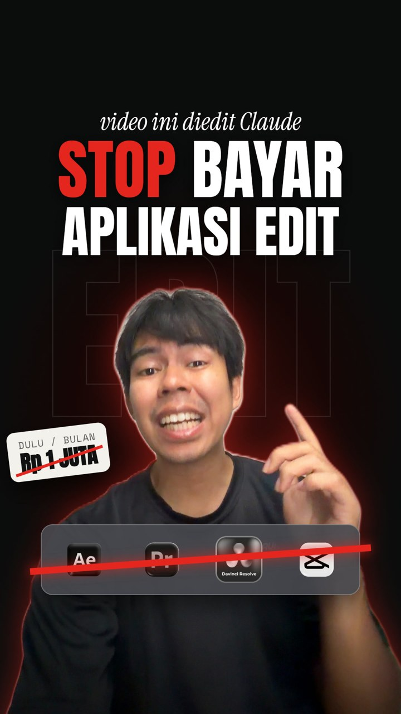
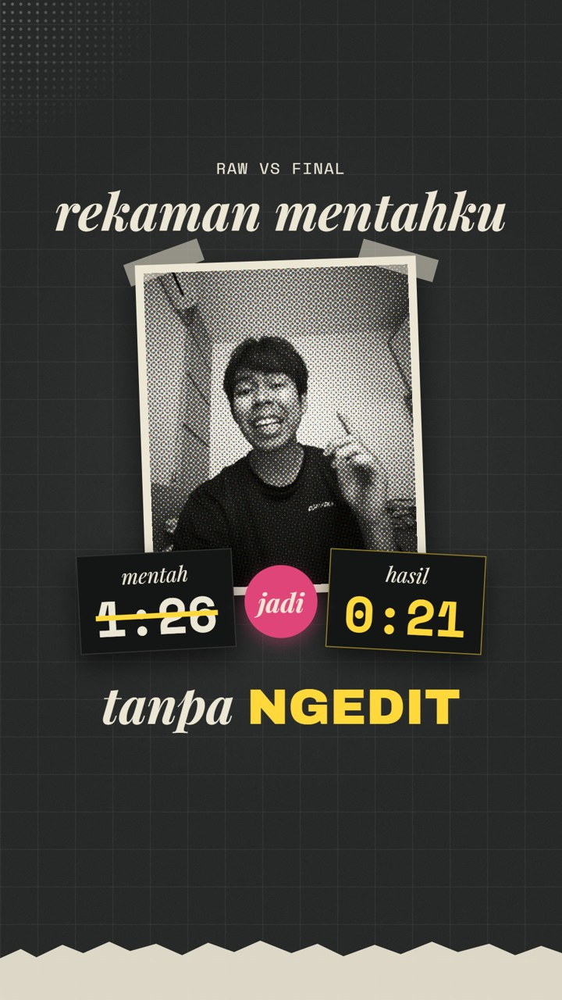
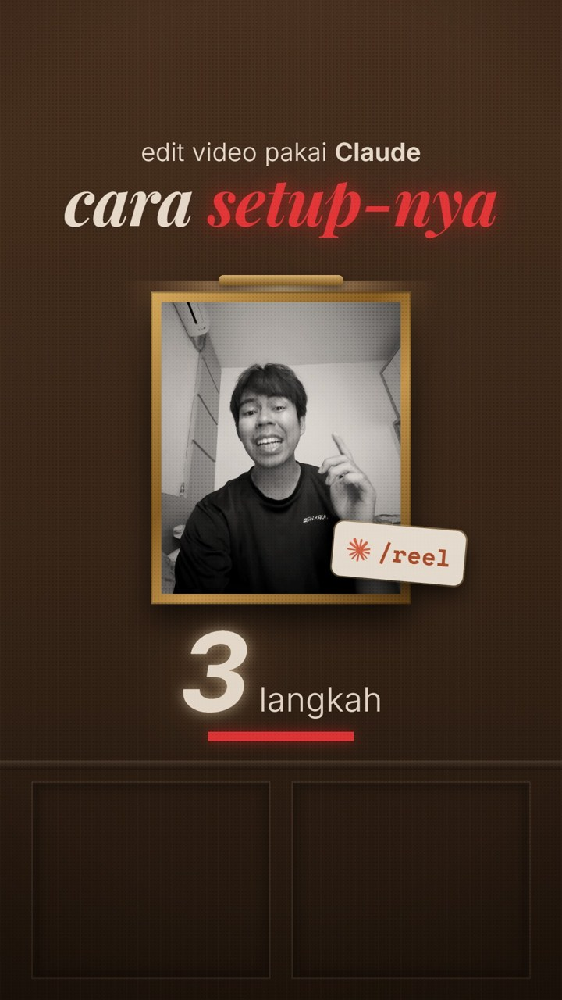

# Video pipeline: script to finished Reel

```
Claude writes the script + effect cues  ->  you approve  ->  you shoot
->  Claude picks takes, cuts, adds effects + captions  ->  you watch the preview, give notes
->  final.mp4 + cover + post caption  ->  you post
```

Runs on your own computer through Claude Code. Your video files stay on it; Claude reads transcripts
and a few still frames to check the edit.

**📖 Step-by-step manual: [Bahasa Indonesia](MANUAL.md) · [English](MANUAL.en.md)**
**🎬 Example results: [`examples/`](examples/)** · **🙏 [Credits](CREDITS.md)**

| [](examples/01-stop-langganan.mp4) | [](examples/02-raw-vs-final.mp4) | [](examples/03-setup-part-2.mp4) |
|---|---|---|
| Stop langganan aplikasi edit | Raw vs final | Setup part 2 |

The motion-graphics look of these examples was added with [HyperFrames](https://hyperframes.heygen.com);
the pipeline itself does the script, takes, cuts, effects, captions, music, cover and caption.

## Setup (once)

The whole workflow is a Claude skill: [`.claude/skills/reel/SKILL.md`](.claude/skills/reel/SKILL.md).
Claude Code loads it automatically whenever you open this folder, so `/reel` just works there.

1. Install **Claude Code** (or use the **Code** tab in the Claude desktop app) and **Python 3.10+**
   (Windows: `winget install Python.Python.3.12`, Mac: `brew install python@3.12`).
2. Get this folder onto your PC: `git clone https://github.com/kidsavagez/CLAUDE-VIDEO-PIPLINE.git`, or Code → Download ZIP.
3. Open the folder in Claude Code and type `/reel`.

The first time, Claude sets everything up for you: ffmpeg and git if missing, then
`install.py` (a `.venv/` with the transcriber and effects libraries, plus
[claude-video-effects](https://github.com/Vibha-Ramprakash/claude-video-effects) pinned to a
reviewed commit), then the self-test. `9/9 passed` means cutting, captions and export work on
your machine.

**Want `/reel` in every folder, not just this one?** Run `python install.py --global` once. It
copies the skill into `~/.claude/skills/reel/` with this folder's paths filled in. Run it again
after you update the pipeline, or the global copy goes stale.

**Claude in the browser or the phone app (claude.ai chat)** cannot run this: the editing needs
ffmpeg, your raw footage and your computer's CPU. The brief and the caption steps would work
there, the editing would not.

## Use

In Claude Code, in the pipeline folder, type:

```
/reel ide: kenapa freelancer kehilangan klien karena kalimat pertama di DM
```

1. **Brief.** Claude writes hook options, the script and where each effect lands. You approve or change it.
2. **Shoot.** Follow [`templates/shooting.md`](templates/shooting.md). The important one: made a mistake?
   Pause, then say the whole line again. Drop the files into the project's `raw/` folder.
3. **Edit.** Claude transcribes, keeps the last complete take of every line, cuts filler and dead
   air, renders the effects, adds captions and on-screen text.
4. **Preview.** You watch `preview/preview_v1.mp4` and reply in plain words: "line 3 pakai take
   pertama", "efek di detik 7 kebesaran", "keep the joke at 0:14".
5. **Final.** `final/final.mp4` (1080x1920), `final/cover.jpg`, `final/caption.md`. You post it.

## Your editing style

Send Claude 1 to 3 reference Reels whose edit you like and say "learn this style". It measures
them (cuts per minute, shot length, loudness), looks at frame sheets, and writes
`styles/<name>.json` + `styles/<name>.md`. Correct what it got wrong. Every video after that uses it.

**What it cannot copy:** motion it only sees as still frames, sound design, and anything the 51
effects cannot do. Point at exact moments ("the zoom at 0:07") to get closer.

## What it does and does not do

| Does | Does not |
|---|---|
| Pick the last complete take of each script line, flag missing lines | Judge your energy or delivery |
| Cut filler (eh, emm, um) and dead air, with cut points snapped to real silence; burst transcription for heavy restarts | B-roll you have not provided |
| 51 face-tracking effects, placed on the word you choose | Transitions and sound effects (add in CapCut, or build motion graphics with HyperFrames) |
| Word-by-word captions, on-screen text, -14 LUFS loudness, music that ducks under your voice, free music made locally (MusicGen) | Trending Instagram audio (licensed inside the app only) |
| Voice-only reels: a clean cut voice track plus word timings | Design the motion graphics by itself |
| Preview, notes, re-render loop | Post anything |

## Speed (rough, CPU only, needs measuring on your PC)

Transcribing and cutting a 60-second Reel takes a minute or two. The effects render is the slow
part: every frame goes through face tracking, so expect several minutes. An NVIDIA GPU speeds up
transcription only.

## Files

```
install.py              setup (Claude runs it the first time; --music for MusicGen, --global for every folder)
.claude/skills/reel/   the /reel skill: the whole workflow, loaded automatically in this folder
scripts/new_project.py  make a project folder
scripts/transcribe.py   word timestamps (faster-whisper)
scripts/burst_transcribe.py  transcribe burst by burst, for recordings with many restarts
scripts/snap_words.py   trim word spans that swallowed a pause
scripts/align.py        match speech to the script, choose takes  -> work/edl.json
scripts/cut.py          render the cut, 1080x1920                 -> work/cut.mp4
scripts/cut_voice.py    voice-only: clean cut voice + word timings -> work/voice.wav
scripts/music_bed.py    background music with MusicGen (install.py --music)
scripts/effects.py      plan / check / render effects             -> work/fx.mp4
scripts/captions.py     captions + on-screen text                 -> work/captions.ass
scripts/finish.py       preview, final, cover, check frames
scripts/style_ref.py    measure a reference edit
scripts/selftest.py     prove it works without a camera
styles/default.json     the base style every style overrides
templates/shooting.md   how to shoot so the edit is automatic
projects/               your videos (not in git)
examples/               three finished Reels made with this pipeline (720p)
MANUAL.md, MANUAL.en.md step-by-step manual with example prompts
CREDITS.md              the open-source repos and models this uses
```
